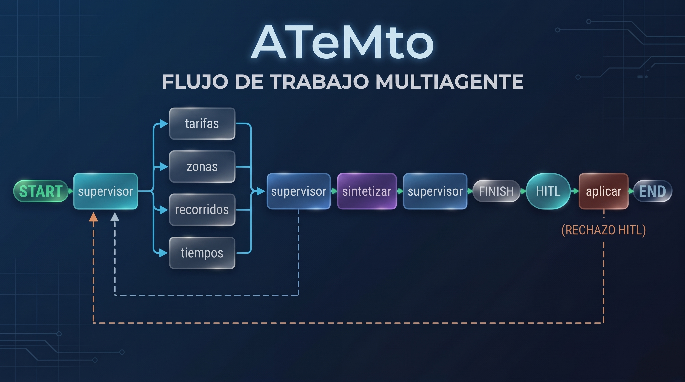
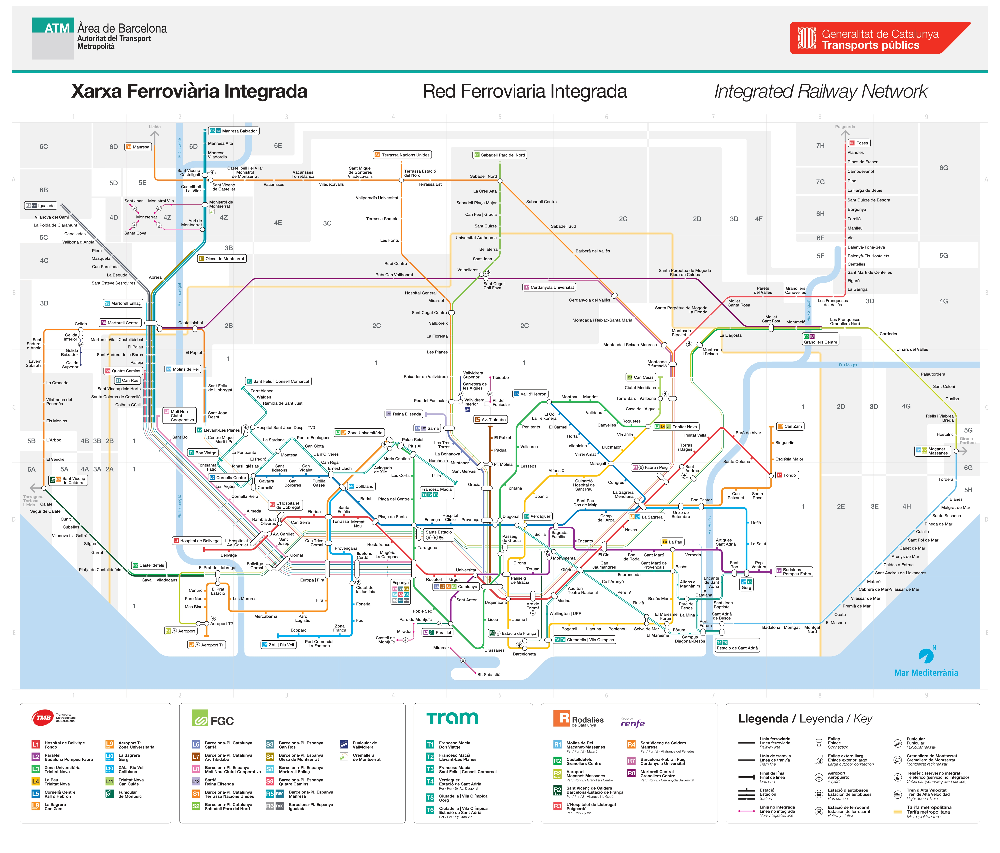

# Memoría del proyecto de multiagente

En este apartado se describen los detalles de arquitéctura relacionados con la construcción del multiagente en LangChang.

## Workflow LangGraph



```text
START -> supervisor ──┬── tarifas ──────────┐
          ▲  ▲        ├── zonas ────────────┼──► supervisor -> sintetizar -> supervisor -> FINISH -> HITL -> aplicar -> END
          │  │        ├── recorridos ───────┤        │                                                          │
          │  │        └── tiempos   ────────┘        │                                                     (RECHAZO HITL)
          │  │                                       │                                                          │    
          │  └───────────────────────────────────────┘                                                          │
          └─────────────────────────────────────────────────────────────────────────────────────────────────────┘
```
A continuación se describen los nodos:
* **Supervisor**: Encargado de decidir si se llama a un especialista y de continuar el blucle o finalizarlo (previo al HITL si toca).
* **Tarifas**: Especialista en tarifas. Idealmente usará el RAG de tarifas.
* **Zonas**: Especialista sobre las zonas a la que pertence una población. Idealmente llamará a una tool determinista para extraer la información.
* **Recorridos**: Especialistas en definir un recorrido dentro de la red de ATM. Principalmente usará el asset plano_ATM.jpg
* **Tiempos**: Especialista en definir cuanto tardará un convoy de TMB en llegar a una estación. Idealmente usará la API de iMetro.

## tools 
* **rag_ask_tarifas**: Tool que pregunta al RAG sobre tarifas.
  * Tipo de tool: RAG Completo 
  * Determinista?: No
* **zonas_poblacion_text**: Tool que revisa si en un texto aparece una o varias poblaciones incluidas en la red ATM y devuelve la zona, el sector y si es tarifa metropolitana, de cada una de las poblaciones encontradas.
  * Tipo de tool: Herramienta auxiliar determinista.
  * Determinista?: Si
  * Observaciones: Se ha reaprovechado la implementación de extracción de zonas del RAG del csv de municipios.
* **calcular_ruta_plano**: Tool que devuelve como ir de una estación a otra. Para ello se abre un documento de tipo imagen con el plano ferroviario de ATM y se le pasa al modelo para que lo consulte.
  * Tipo de tool: Multimodal.
  * Determinista?: No
* **API_llegada_tren_estacion_tmb**: Llama a la API de iMetro (para más detalle ver apartado correspondiente) que calcula, dada una estación de TMB, el tiempo que tardará en llegar los siguientes convoys a esa estación, en todas las direcciones y líneas.
  * Tipo de tool: API
  * Determinista?: Si
  * Observaciones: Se ha detectado un mal funcionamiento en la API que hace que, en aquellas estaciones que tienen varias líneas, solo devuelva información de una sola línea. Esto ha sido escalado al equipo de developer@tmb.cat. A cierre de proyecto no ha sido resuelto.
* **obtener_id_estacion**: Esta tool se podría haber integrado dentro de API_llegada_tren_estacion_tmb, ya que es la única forma de obtener el id de la estación necesaria para llamar a la API, pero se ha decidido separar para comprobar, a modo didactico, como el modelo la usa para poder utilizar la tool de la API. 
  * Tipo de tool: mini-RAG / LLM
  * Determinista?: No
  * Observaciones:
    * Se hace una llamada a Gemini pasandole un csv preformateado con la relación código y estación.
    * Inicialmente se planteo hacer una función determinista como en el caso de las poblaciones. No obstante se detecto que en caso de escribir las poblaciones con errores, daba mucho mejor resultado hacerlo con un LLM y se decidió dejar así.
* **obtener_nombre_estacion_oficial**: Esta tool dada un id de estación devuelve el nombre oficial de una estación. Esta función se ha construido por si el modelo en algún momento necesita aclarar como se denomina una estación concreta que pueda aparecer en la API API_llegada_tren_estacion_tmb. Su uso debería ser para casos muy puntuales y realmente no se han encontrado casos de uso.
  * Tipo de tool: Herramienta auxiliar determinista.
  * Determinista?: Si

## API iMetro

Apartado especial para explicar las particularidades de la API de iMetro utilizada en el proyecto:

* Se utilizará la API de iMetro https://developer.tmb.cat/api-docs/v1/imetro
* Se requiere un app_id y un app_key. Para más información visitar https://developer.tmb.cat/docs/getting-started
* La API devuelve en JSON un esta estructura:

```text
{
"timestamp": 1746449254397, // timestamp de la consulta
"linies": [		// Per cada linia...
  {
    //Atributs de la linia
    "codi_linia": 1,
    "nom_linia": "L1",
    "nom_familia": "Metro",
    "codi_familia": 1,
    "color_linia": "CE1126",
    "estacions": [  // per cada estació per la que passa la linia
      {
        "codi_via": 1,		// Via 1 o 2
        "id_sentit": 1,		// 1 = Anada, 2 = Tornada
        "codi_estacio": 120,
        "linies_trajectes": [	// per cada trajecte que pot tenir la línia, en el cas de metro normalment 1 per sentit
          {
            "codi_linia": 1,
            "nom_linia": "L1",
            "color_linia": "CE1126",
            "codi_trajecte": "0011",
            "desti_trajecte": "Fondo", // Destinació del trajecte
            "propers_trens": [			// llista dels propers trens que arribaran a la estació
              {
                "codi_servei": "120",				// codi del servei que té assignat el tren (es veu al frontal del tren)
                "temps_arribada": 1746449431000 	// timestamp absolut del moment d'arribada a la estació
              },
              {
                "codi_servei": "121",
                "temps_arribada": 1746449707000
              }
            ]
          }
        ]
      },
    ]
  }
]}
```
### Problemas detectados

Se ha detectado que sobre estaciones con varias líneas que solo devuelve tiempos de la primera estación. Se ha enviado un email al email de soporte (developer@tmb.cat) indicando esta anomalía. A fecha de cierre del proyecto no ha habído respuesta.

```text
para:	developer@tmb.cat
fecha:	12 oct 2026, 16:28
asunto:	Problemes amb API iMetro

Bona tarda,

Em poso en contacte amb vosaltres perquè estic consumint la API:

https://api.tmb.cat/v1/itransit/metro/estacions?estacions=<id_estacio>&app_id=<your_app_id>&app_key=<your_app_key>

per una pràctica d'un curs de programació que estic fent i em trobo que algunes de les estacions que son a mes d’una línia, nomes retorna informació d’una línia.

Per exemple, la línia 339 que es trinitat nova nomes retorna informació de la línia L3, quan tindria que retornar informació de L4 y L11. Un altre exemple podria ser la 225 Gorg que nomes retorna informació de L2.

Hi ha algunes excepcions, con les estacions 914 o 932 que sí retorna informació  sobre totes les línies, tot i que està mesclada.

No se si estic fent alguna cosa mala ment o es algun tipus de bug.

La informació de les estacions la trec del excel que es descarrega de https://developer.tmb.cat/data/estacions

Moltes gracies,
```

## Arreglos/modificaciones proyecto anterior PB-RAG-ASISTENTE-TARIFAS-ATM-BCN:

En este apartado se describen los arreglos y mejoras que se han realizado sobre el RAG para este proyecto:

* En requirements: pandas>=2.0.0, <3.0.0 ya que daba problemas sobre windows.
* Se incluye el wrapper "rag_ask(consulta: str)" en rag_service.py para usarlo como tool.
* Se renombra app.py por app_rag.py para mantener el asistente de la primera versión.
* Se excluye el documento 24_Descripcion_tipos_billetes_TMB.pdf dado que se trata 100% como imagen y al no devolver texto no genera contenido en el RAG.
* Limpieza de prints y comentarios de depuración que solo ensuciaban el código.

## Decisiones técnicas
En este apartado se describen algunas decisiones técnicas importantes que se han tomado y que se considera relevantes nombrarlas.

* Se afina el prompt del nodo_supervisor para que solo llame a los nodos que necesite y no a todos.
* Se afina el nodo_sintetizar para que no invente planes en caso de que no se capaz de generar un plan con la pregunta del usuario.
* Se afina el prompt del nodo_sintetizar para que devuelva lo que es capaz de hacer en caso de que le saluden o le pregunten cosas genéricas. 
* Se planteó limitar las tools por nodo de una manera más controlada. Por ejemplo que NODO TARIFAS solo pudiera llamar a rag_ask_tarifas o que NODO ZONAS solo pudiera llamar a zonas_poblacion_text, pero se detecto que era excesivamente restrictivo, de tal foma que los agente al tener poca información no sabían que hacer. Sería un tema a analizar a futuro para afinar el sistema, pero en esta fase ha quedado fuera de scope. 

## Cosas a mejorar
* Acotar la allowlist de las tools por nodo en vez de a nivel general, para evitar que un nodo llame a una tool que no tiene nada que ver con su responsabilidad.

## Informe de resultados

En este apartado se describen los 5 solicitudes de la academia.

### Grafo

Ver apartados anteriores en este mismo documento

### Tools

Ver apartados anteriores en este mismo documento

### HITL

*"Que se observa en 1 rechazo de HITL y en 1 aprobación de HITL"*

* **Rechazo:** Con rechazo comienza de nuevo el ciclo, esperando pregunta del usuario y comenzando el ciclo con el nodo supervisor.
* **Aprobación:** Con aprobación se dá la conversación por finalizada y habría que comenzar nueva conversación.

### Multimodal

La imagen utilizada es la siguiente:



La imagen incluye toda la red de ATM. El LLM al consultarla es capaz de saber el recorrido que hay que hacer entre dos estaciones.

### Fallos y mejoras

* Mejora: Acotar la allowlist de las tools por nodo en vez de a nivel general, para evitar que un nodo llame a una tool que no tiene nada que ver con su responsabilidad.
* Mejora: Despliegue en un entorno de producción MLOPS.
* Mejora: Mantener los checkpointer en disco.
* Mejora: Que el agente mantenga una memoría entre peticiones.
* Mejora: Agente con memoria in-eternum e interacción más directa. Mejor integración entre agnete, chat y usuario.


